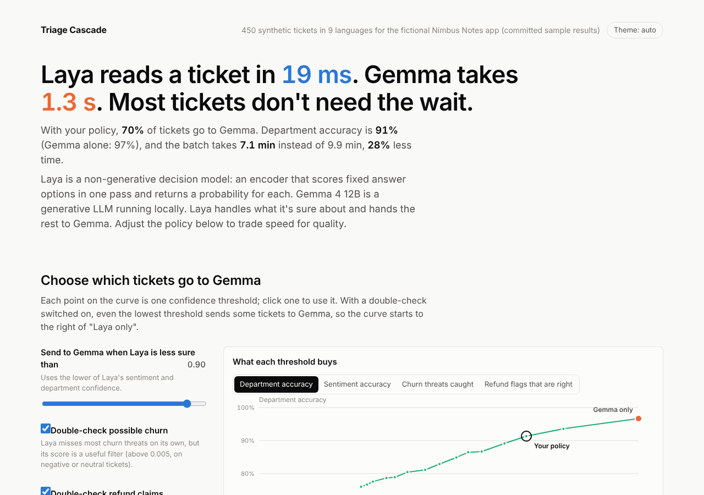
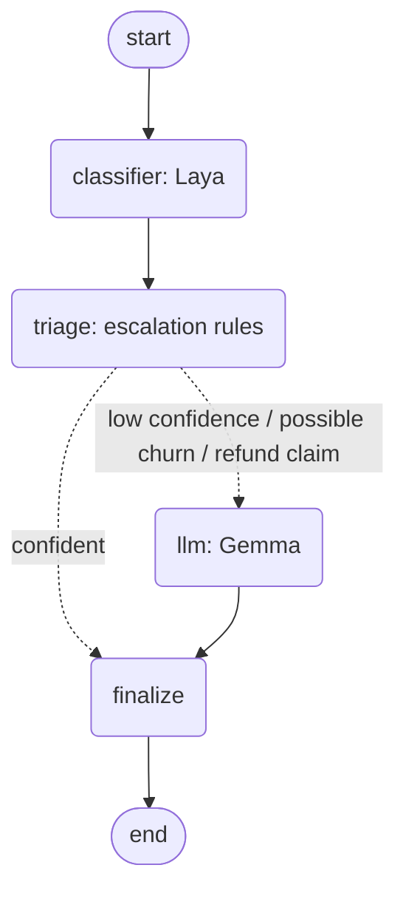

# Triage Cascade

A multilingual support-ticket triage pipeline where a small classifier answers every ticket first and a generative LLM is called only when needed.

- **Classifier tier: [Laya](https://huggingface.co/convaiinnovations/laya)**, a non-generative decision model. It answers every ticket in about 20 ms and returns a probability for each answer.
- **LLM tier: Gemma 4 12B**, served locally. It takes about 1.3 s per ticket and only sees tickets the classifier is unsure about, or that might be a churn threat or a refund claim.

A dashboard shows what each escalation policy costs and what it buys. Everything runs locally on one desktop GPU.



## The question

Many LLM classification demos send every item to a large model. This project measures the alternative:

**How much of the work can a cheap model do on its own, how do we know which tickets it can't handle, and what does escalating the rest actually buy?**

Every ticket gets five answers: sentiment, department, urgency, churn risk and refund request.

## The two tiers

| | Classifier tier | LLM tier |
| --- | --- | --- |
| Model | Laya (ModernBERT-large or mmBERT-base encoder + decision head, ~0.3–0.4B parameters) | Gemma 4 12B instruct, quantized, thinking off |
| How it answers | Scores every option of every question in **one forward pass** and returns a probability for each. It never generates text. | Generates a JSON answer token by token. |
| Output | Typed answers with probabilities: choice, score, yes/no | Free text, parsed and validated against a schema |
| Time per ticket here | ~20 ms | ~1.3 s |

Laya's model card describes it as a "System 1" decision model, in the sense of Kahneman's fast, intuitive judgement. This project tests how far that fast judgement can be trusted and when to hand off to the slower, deliberate model. "Faster" is relative: the gap depends on the hardware and on how expensive the LLM call is.

## How it works



1. **Generate labelled data** (`pipeline/generate.py`). A seeded sampler with business rules picks the labels first, then the LLM writes a ticket to match them. That gives ground truth without manual labelling. The result is 450 tickets, 50 each in English, Traditional Chinese, Japanese, Korean, Spanish, Portuguese, French, German and Hindi. They include sarcasm, mixed sentiment, hidden churn hints and code-switching.
2. **Classifier tier** (`pipeline/classifier.py`). Laya answers all five questions in one forward pass. Language comes from Laya's router, not from a question.
3. **Evaluate** (`pipeline/evaluate.py`). Precision and recall, calibration (reliability bins and ECE), accuracy vs. confidence threshold, cross-validated cut-offs, and breakdowns by language and writing style.
4. **LLM baseline** (`pipeline/llm.py`). Gemma labels every ticket blind, using the same label definitions Laya gets.
5. **Cascade** (`pipeline/graph.py`, `pipeline/policy.py`). A LangGraph flow escalates a ticket to the LLM when the classifier is unsure, when its churn score passes a low filter, or when it flags a refund. `--sweep` compares policies offline.
6. **Serve and show** (`api/`, `web/`). FastAPI over SQLite, and a React + TypeScript dashboard with a policy lab, calibration charts, a per-language comparison, a ticket inspector and live triage.

## Findings

Accuracy is measured against the labels the tickets were generated from.

| Policy | Sent to LLM | Sentiment | Department | Churn caught | Refund flags right | Time, 450 tickets |
| --- | --- | --- | --- | --- | --- | --- |
| Classifier only | 0% | 72% | 70% | 3% | 71% | 9 s |
| Budget: churn + refund checks only | 26% | 73% | 76% | 52% | 95% | 2.8 min |
| Balanced: confidence < 0.9 + both checks | 70% | 81% | 91% | 67% | 89% | 7.1 min |
| LLM only | 100% | 83% | 97% | 100% | 80% | 9.9 min |

- **The classifier's confidence ranks answers well but overstates them.** Answers above 0.9 confidence are right 84% of the time. Between 0.7 and 0.8, only about half are (ECE 0.15 for sentiment, 0.20 for department). That's good enough for a threshold, but not for reading as a probability.
- **The classifier can't detect churn on its own.** Recall is 3% at a 0.5 cut-off, but its score works as a cheap filter for which tickets the LLM should check.
- **The cascade beats either model on one metric.** Refund precision is 89–95% routed, vs. 80% for the LLM alone, because the classifier's strict cut-off settles the easy cases.
- **Some limits are in the labels, not the models.** Urgency sits near 52% for both models, and sentiment tops out at 83% even for the LLM.
- **Longer option descriptions hurt the classifier.** Department accuracy fell from 70% to 61% with more explanatory wording.
- **Romanized Hindi** ("login nahi ho rha") is detected as Italian by Laya's router.
- **Routing saves about 30% of the time here**, because Gemma with thinking off is fast. With a 10 s "thinking" model or a paid API, the same policy saves far more. The dashboard's cost setting shows this.
- **Evaluation leakage, measured.** Giving the LLM the generator's own label wording raised its department score from 97% to 99%.

**Caveats.** The data is synthetic, and the same LLM wrote it, so the LLM's scores are likely optimistic. About 5% of the urgency labels are noisy. The full analysis, evaluation pitfalls and next steps are in [`docs/REPORT.md`](docs/REPORT.md).

### About the numbers

All results and timings come from one run on this setup:

- Windows 11 (native, no WSL), Python 3.14
- NVIDIA RTX 4080 Super (16 GB), CUDA PyTorch (cu130)
- Laya 0.3.22, with the English and multilingual checkpoints loaded
- Gemma 4 12B instruct (Q4/Q5 GGUF) in LM Studio, thinking off

**Your mileage will vary.** Latency depends on your GPU, quantization and LLM server settings. On CPU, Laya takes about 250 ms per ticket instead of 20 ms. Accuracy depends on the generated dataset: a new run produces different tickets. The exact database behind these numbers is committed in [`sample_data/`](sample_data/), so the dashboard and `pytest` reproduce them without a GPU.

## Run it

### Dashboard only (no GPU or LLM needed)

The API falls back to the committed results in `sample_data/` when you haven't run the pipeline yourself.

```bash
python -m venv .venv
.venv\Scripts\activate            # Windows; on macOS/Linux: source .venv/bin/activate
pip install -r requirements.txt

uvicorn api.main:app --port 8000  # API, docs at http://localhost:8000/docs
cd web && npm install && npm run dev   # in a second terminal: http://localhost:5173
```

Everything except "Triage a new message" works in this mode. Live triage needs the full setup below.

### Full pipeline

You need an NVIDIA GPU (a CPU works, but slowly) and an OpenAI-compatible LLM server. These steps use [LM Studio](https://lmstudio.ai/) serving `gemma-4-12b-it` with thinking off.

```powershell
# PyTorch with CUDA first: PyPI's Windows build is CPU-only. See https://pytorch.org/get-started/locally/
pip install torch --index-url https://download.pytorch.org/whl/cu130
pip install -r requirements.txt

# Point at your LLM server (defaults shown)
$env:LLM_BASE_URL = "http://localhost:1234/v1"
$env:LLM_MODEL    = "gemma-4-12b-it"

# Each step writes to data/triage.sqlite (git-ignored)
python scripts/check_env.py                 # PyTorch/CUDA, Laya and LLM server check
python -m pipeline.generate --n 450         # labelled tickets (~11 min)
python -m pipeline.classifier               # Laya on every ticket (~20 s)
python -m pipeline.evaluate                 # metrics -> data/eval_report.json
python -m pipeline.llm                      # LLM baseline (~11 min)
python -m pipeline.graph --sweep            # compare escalation policies
python -m pipeline.graph --text "Mi app no sincroniza"   # one message, fully live
```

Once `data/triage.sqlite` exists, the API serves it instead of the sample data. Call `POST /api/reload` after re-running a step.

### Tests

```bash
pip install pytest httpx ruff
pytest           # schema, escalation rules, and API against sample_data/
ruff check .
```

## Repository layout

```
triage-cascade/
├── pipeline/
│   ├── config.py        paths, LLM endpoint, fictional company
│   ├── db.py            SQLite schema
│   ├── generate.py      labelled ticket generator
│   ├── questions.py     question sets asked of the classifier (v1, v2)
│   ├── classifier.py    classifier tier: Laya batch run
│   ├── evaluate.py      classifier metrics report
│   ├── llm.py           LLM tier: labelling and baseline
│   ├── policy.py        escalation rules and policy evaluation
│   └── graph.py         LangGraph cascade, policy sweep, live mode
├── api/main.py          FastAPI backend
├── web/                 React + TypeScript dashboard (Vite)
├── scripts/check_env.py environment and model check
├── sample_data/         results of the run above (SQLite + JSON reports)
├── tests/
└── docs/REPORT.md       full write-up
```

## License

The code in this repository is released under the [MIT License](LICENSE).

The models are not included and keep their own terms: Laya is Apache 2.0, and Gemma is covered by Google's Gemma terms of use. The synthetic tickets in `sample_data/` were generated with Gemma.
